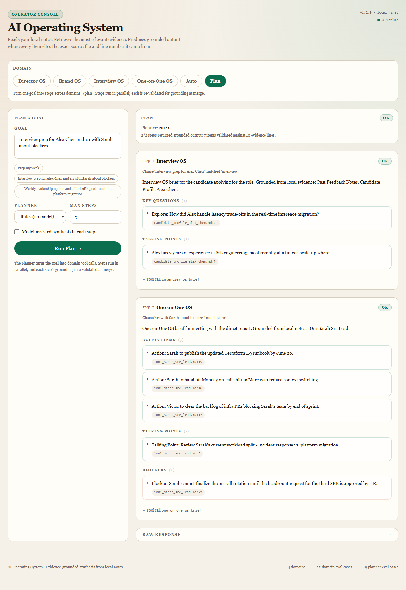
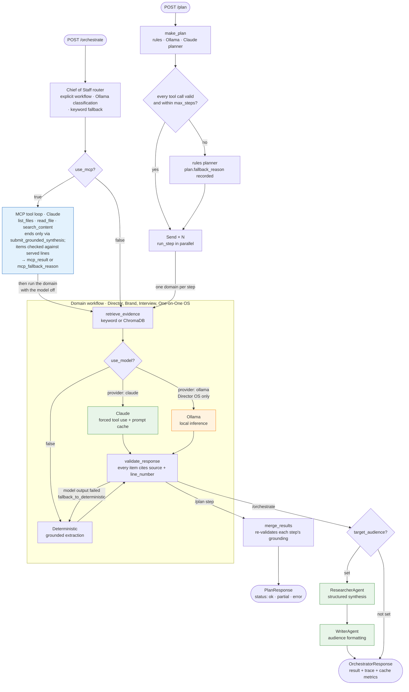
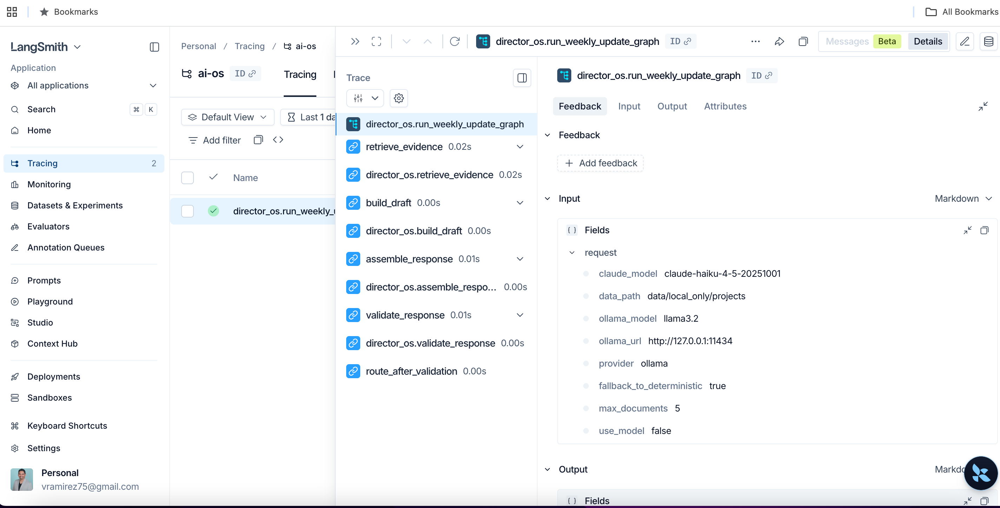

# AI Operating System (AI-OS)

AI-OS is an evidence-grounded workflow platform that synthesizes fragmented information — project notes, team signals, candidate briefs, meeting prep — into structured output where every item cites its source file and line. An LLM router dispatches each request to one of four LangGraph domain workflows; every workflow validates its own grounding and falls back to a deterministic path when the model fails.

Four workflow domains share a common architecture: a routing layer that classifies incoming requests and dispatches them to the right domain graph, a retrieval layer that pulls relevant evidence from local markdown files or a semantic vector store, a synthesis layer that produces structured output with mandatory source citations, and a validation layer that enforces grounding before any response reaches the API.

---

**Recruiter / hiring manager walkthrough:** [SHOWCASE.md](SHOWCASE.md) — use cases, domain walkthroughs with live curl examples, and the engineering decisions behind the system.

---

## See it run

One goal goes in. The planner splits it into two domain workflows, runs them in parallel, and returns items that each cite the file and line they came from. No API key or model needed.



**1. Install and start the API** (Python 3.11+):

```bash
python -m venv .venv && source .venv/bin/activate
pip install -e ".[dev]"
uvicorn apps.api.main:app
```

**2. Send a goal to the planner:**

```bash
curl -X POST http://127.0.0.1:8000/plan \
  -H "Content-Type: application/json" \
  -d '{"goal": "Interview prep for Alex Chen and 1:1 with Sarah about blockers"}'
```

**3. Read the grounded result** (trimmed; the full response also carries the evidence lines and a per-step trace):

```json
{
  "status": "ok",
  "plan": {
    "planner_used": "rules",
    "steps": [
      {"step_id": 1, "tool_name": "interview_os_brief",  "rationale": "Clause 'Interview prep for Alex Chen' matched 'interview'."},
      {"step_id": 2, "tool_name": "one_on_one_os_brief", "rationale": "Clause '1:1 with Sarah about blockers' matched '1:1'."}
    ]
  },
  "steps": [
    {
      "workflow_id": "interview_os.brief",
      "status": "ok",
      "result": {
        "key_questions": [
          {"text": "Explore: How did Alex handle latency trade-offs in the real-time inference migration?",
           "source": "candidate_profile_alex_chen.md", "line_number": 23}
        ]
      }
    },
    {
      "workflow_id": "one_on_one_os.brief",
      "status": "ok",
      "result": {
        "blockers": [
          {"text": "Blocker: Sarah cannot finalize the on-call rotation until the headcount request for the third SRE is approved by HR.",
           "source": "1on1_sarah_sre_lead.md", "line_number": 22}
        ]
      }
    }
  ]
}
```

Every item points at a real line in `data/local_only/`, and the supervisor re-checks each citation against the retrieved evidence before the response leaves the API. For the browser UI, model-backed synthesis, and evals, see [Quick start](#quick-start) and [Planner](#planner).

---

## Why this matters

Production AI deployment fails in predictable ways: hallucinated content with no citation trail, model paths that break silently when the LLM is unavailable, no way to measure whether synthesis quality regresses as the system evolves, and observability that requires code changes to turn on or off. AI-OS is designed to address all four at the architecture level — not as afterthoughts, but as invariants.

Evidence grounding is enforced at the schema level via forced tool use: every output item must carry a `source` filename and `line_number`. No response path returns an uncited item. That includes the model-directed MCP tool loop, which must finish through a forced submit tool whose items are validated against the exact lines the model read. Deterministic fallback is always available — if model synthesis fails or no API key is present, the system produces grounded output from keyword extraction with no silent degradation. CI runs the 22 domain eval cases on the keyword retrieval path and the 19-case routing/planning set on every PR; semantic (ChromaDB) and live-Claude results are run on demand and committed. Observability is opt-in by environment variable: setting `LANGSMITH_TRACING=true` emits node-level traces across all four domain graphs with no code changes.

---

## Domains

| Domain | What it synthesizes |
|---|---|
| **Director OS** | Project notes → wins, risks, next steps for a weekly leadership update |
| **Brand OS** | Technical work notes → content post outlines, podcast angles, repo improvements |
| **Interview OS** | Hiring notes → candidate brief with key questions, talking points, red flags |
| **One-on-One OS** | Direct report notes → meeting brief with action items, blockers, kudos |

---

## What this demonstrates

| Capability | Implementation |
|---|---|
| Multi-domain planning with parallel execution | `POST /plan`: rules, Ollama, or Claude planner turns a goal into domain tool calls; a LangGraph supervisor fans them out with `Send` and re-validates grounding at merge |
| LLM routing across domains | Chief of Staff router (local Ollama classification, keyword fallback) + 4 domain LangGraph graphs |
| Domain registry as tool definitions | `packages/shared/domains/`: one `DomainSpec` per domain drives the router prompt, API routes, and MCP tools; model-facing input schemas exclude provider/model/fallback settings; snapshot-tested |
| In-process MCP tool loop | `packages/shared/mcp/filesystem_server.py` + `orchestrator_integration.py` |
| Standalone MCP server | `apps/mcp/server.py` — all 4 domains as MCP tools |
| Schema-enforced evidence grounding | Forced tool use with required `source` + `line_number` fields |
| Provider abstraction | `base.py` interface; `claude.py` / `ollama.py` / `grounding.py` implementations |
| Pluggable retrieval backend | Keyword (`local_files.py`) or semantic (`chroma.py`) via env var |
| Two-stage agent pipeline | `ResearcherAgent → WriterAgent` with structured handoff contract |
| LLM evaluation framework | 22 domain cases across 3 retrieval paths + 19 routing/planning cases, committed results, CI-gated |
| Node-level observability | LangSmith `@traceable` on all 4 domain graphs — silent no-op without config |
| Operator UI | Next.js frontend (`apps/web`) with per-domain tabs, an Auto tab for `/orchestrate`, and a Plan tab for `/plan`; type-checked and built in CI |
| Prompt caching + cost visibility | `cache_read_input_tokens` / `cache_creation_input_tokens` in every `WorkflowTrace` |

The architecture is designed to be adapted. The provider layer, the in-process filesystem tool loop, and the standalone MCP server are all swappable — designed for the kind of environment customization that enterprise AI work requires.

---

## Scope today and the path to orchestration

AI-OS has two layers. Underneath are **fixed, validated domain workflows**: predictable, cheap, and testable. On top is a **planner** that decides which of those workflows a goal needs and calls them as tools. A planner is only as reliable as the tools it calls, so the workflows came first.

| Shipped | Still ahead (Phase 9 in [docs/plan.md](docs/plan.md)) |
|---|---|
| ✅ **9a** Domain registry in `packages/shared/domains/`: each domain registers its schemas, routing rules, and a model-facing tool definition; the router, API, and MCP server are derived from it | **9d** Requests are stateless; LangGraph checkpointing, run history, and human approval come next |
| ✅ **9b** `POST /plan`: a goal ("prep my week") becomes steps across domains, run in parallel, each re-validated for grounding at merge | **9e** Local markdown is the only data source; external MCP servers (GitHub first) are next |
| ✅ **9b** Routing and planning eval set (19 cases) gated in CI | **9f** Hosted demo and walkthrough video |
| ✅ **9c** The MCP tool loop ends in a forced `submit_grounded_synthesis` call; every item is validated against the lines the model read, or the synthesis is dropped with a recorded reason | |

---

## Planner

`POST /plan` takes a goal and returns a plan plus one grounded result per step.

```bash
curl -X POST http://127.0.0.1:8000/plan \
  -H "Content-Type: application/json" \
  -d '{"goal": "Interview prep for Alex Chen and 1:1 with Sarah about blockers"}'
```

```text
make_plan ──Send×N──▶ run_step (parallel) ──▶ merge_results
```

- **Three planners, one contract.** `rules` (default) splits the goal into clauses and routes each with the router's keyword rules; it needs no model. `ollama` and `claude` receive every registered domain as a tool and plan by making parallel tool calls, so planning *is* tool selection.
- **A model plan is never trusted as-is.** Each call must name a registered tool, and its arguments must pass that domain's input schema. That schema rejects a `data_path` outside `data/local_only/` or one that does not exist, and has no provider, model, or fallback fields; those come only from the operator's request. A plan over `max_steps` is rejected. Any failure falls back to the rules planner, and the response records why in `plan.fallback_reason`.
- **Grounding is checked again at the merge.** Every step's grounded items are re-validated against that step's evidence before they reach the response, so a regressed workflow cannot slip an uncited item into a plan.
- **Partial results are kept.** A failing step is reported with its error (`status: "partial"`) and the other steps still return.

**Why a model planner is worth having**, measured on the committed eval set (`evaluations/planner/planning_cases.json`):

| Rules planner | Cases | Exact plan match |
|---|---|---|
| Single-intent routing | 9 | 100% |
| Multi-domain goals with keywords | 5 | 100% |
| Goals with no routing keywords, or "and" inside one deliverable | 5 | **0%** |
| **All cases** | 19 | 73.7% |

The last group ("Help me get ready for my conversation with Priya about her promotion case") is what the model planners exist for. The first model baseline shows the bar is real: `llama3.2` (3B) scores 5/19 overall and 0/5 on that group (`evaluations/planner/results_ollama.json`). Every invalid plan fell back to `rules` and none ran, so the guardrails held, but a local 3B model is not a viable planner. Scoring the Claude planner on the same 19 cases is next. CI gates the rules planner on the 14 cases it should solve. Score a model planner on all 19 with `python scripts/run_evals.py --domain planner --backend ollama` (local, free) or `--backend claude --allow-live` (opt-in, uses the API).

---

## Architecture

The system has three independently configurable layers: routing, retrieval, and synthesis. Swapping any layer — routing model, retrieval backend, synthesis provider — requires a single field change, not a workflow rewrite.

**Routing** — The Chief of Staff router classifies each request using a local LLM with a compact one-token classification prompt (`director_os`, `brand_os`, `interview_os`, `one_on_one_os`). When the local model is unreachable, it falls back to keyword rules automatically. Routing decisions don't need reasoning depth — they need to be fast, free, and zero-data-egress. A cloud LLM call on a classification task that returns one word is waste.

**Retrieval** — Two backends share a common interface. The keyword backend (`local_files.py`) does BM25-style scoring with no external dependencies — it runs in CI with no services required. The semantic backend (`chroma.py`) uses ChromaDB with `nomic-embed-text` embeddings via Ollama for richer recall. The backend selector reads `RETRIEVAL_BACKEND` from the environment and switches automatically. If the Chroma index is absent, it falls through to keyword retrieval.

**Synthesis** — Each domain runs as a compiled LangGraph `StateGraph` with typed state. Director OS nodes: `retrieve_evidence → build_draft → assemble_response → validate_response`; the other three domains combine drafting and assembly into a single `build_response` node. A conditional edge after `validate_response` sends failed model output to the deterministic path when `fallback_to_deterministic=True`. The provider abstraction means switching synthesis providers is a single field on the request — no workflow logic changes.



---

## Key design decisions

**Forced tool use over prompt instructions.** The grounding invariant is enforced via the LLM tool use API's JSON schema, not a system prompt instruction. A prompt instruction achieves correct citation ~95% of the time. A required schema field (`source` + `line_number` on every output item) achieves it structurally: the API call either produces a fully-cited response or raises a parse error, which triggers the deterministic fallback. There is no "approximately cited" middle ground.

**Schema as the single source of truth.** The same Pydantic `BaseModel` definitions drive FastAPI request validation, LangGraph state shape, eval case deserialization from JSON on disk, and LangSmith dataset sync. One schema change propagates through the full stack with no manual wiring.

**Evaluation tests failure modes, not just happy paths.** Each domain's eval suite includes cases for: baseline grounding pass, multi-file retrieval, provider failure (`_FailingProvider`), weak output / empty sections (`_WeakProvider`), and unsupported claims that cite wrong evidence (`_UnsupportedClaimProvider`). All three retrieval paths are CI-gated before merge.

**Multi-agent pipeline via information narrowing.** The `ResearcherAgent → WriterAgent` pipeline is not two models chatting. The researcher produces a structured `ResearchSynthesis` object via tool use. The writer receives only that object — not raw evidence. The writer can rephrase and reformat; it cannot introduce information the researcher didn't extract. Hallucination surface is bounded to the reformatting step.

**Prompt caching on the evidence block.** The evidence block is marked with `cache_control: {"type": "ephemeral"}` on every synthesis call. On repeated queries against the same document set — the normal usage pattern — the LLM reuses the cached KV representation. Savings surface in every `WorkflowTrace` via `cache_read_input_tokens` and `cache_creation_input_tokens`.

---

## Quick start

Requirements: Python 3.11+

```bash
python -m venv .venv && source .venv/bin/activate
pip install -e ".[dev]"
cp .env.example .env
uvicorn apps.api.main:app --reload --env-file .env
```

The system runs fully without any API keys. Model synthesis is opt-in via `use_model=True` on any request.

Two browser UIs sit on the API:

- **Next.js frontend** (`apps/web`): one tab per domain, an **Auto** tab that goes through `/orchestrate` (router, MCP loop, audience formatting), and a **Plan** tab that sends a goal to `/plan` and shows each step's grounded result, status, and tool call. Every item renders with its `source:line_number` citation.

  ```bash
  cd apps/web && npm install && npm run dev   # http://localhost:3000, API must be running
  ```

  The frontend reads the API URL from `NEXT_PUBLIC_API_URL` (default `http://127.0.0.1:8000`); see `apps/web/.env.local.example`.

- **Legacy console** at `http://127.0.0.1:8000/`: a single page served by FastAPI that runs `/orchestrate`, with no build step.

> **Sample data is synthetic.** The 1:1 meeting notes, project updates, and interview materials under `data/local_only/` (`one_on_one/`, `projects/`, `interviews/`) are fictional and were written for demos and evals. The people, team members, and candidates named in them are invented and do not refer to real colleagues.

```bash
# Run all local evals — no API key required
python scripts/run_director_os_evals.py
python scripts/run_brand_os_evals.py
python scripts/run_interview_os_evals.py
python scripts/run_one_on_one_os_evals.py

# Run tests
pytest tests/ -v
```

---

## Working with Claude

Set `ANTHROPIC_API_KEY` in `.env`. The Claude provider activates automatically — no code changes required.

```bash
# Director OS — weekly update with Claude
curl -X POST http://127.0.0.1:8000/director-os/weekly-update \
  -H "Content-Type: application/json" \
  -d '{
    "data_path": "data/local_only/projects",
    "focus": "leadership update",
    "use_model": true,
    "provider": "claude"
  }'
```

The response carries the grounded sections plus `provider_usage` with token and prompt-cache counts. Send the same request through `/orchestrate` to also get a `trace`: which domain ran, which provider and model served it, whether fallback fired, and the cache hits.

```bash
curl -X POST http://127.0.0.1:8000/orchestrate \
  -H "Content-Type: application/json" \
  -d '{"prompt": "Weekly leadership update", "use_model": true, "provider": "claude"}'
```

```json
{
  "selected_workflow": "director_os",
  "trace": {
    "routing_model": "ollama/llama3.2",
    "provider_used": "claude",
    "model_id_used": "claude-haiku-4-5-20251001",
    "fallback_used": false,
    "cache_read_input_tokens": 680,
    "cache_creation_input_tokens": 0
  },
  "result": {"summary": "...", "wins": [...], "risks": [...], "next_steps": [...]}
}
```

With `"use_mcp": true`, `trace.mcp_tool_calls` lists every `list_files` / `read_file` / `search_content` call the model made, and `mcp_result` holds the validated synthesis (see [MCP entry points](#mcp-entry-points)).

Without an API key the Claude call fails and the workflow returns its deterministic result (`fallback_to_deterministic=true`, the default); `trace.fallback_used` records it.

---

## MCP entry points

Two MCP integration patterns:

**In-process tool loop** — When `use_mcp=True` on `/orchestrate`, the LLM calls `list_files`, `read_file`, and `search_content` tools autonomously. The orchestrator executes each call, appends the result to the message history, and continues until the model calls `submit_grounded_synthesis`. No pre-selected evidence — the model decides what to read — but it cannot finish with free text: every round forces a tool call, `read_file` numbers each line, and each submitted item must cite a `source` and `line_number` the tools actually served and match that line's text. A synthesis that fails is dropped (`trace.mcp_fallback_reason` says why) and the deterministic workflow result is returned instead.

**Standalone MCP server** — `apps/mcp/server.py` exports all four domain workflows as MCP tools (`director_os_weekly_update`, `brand_os_content_draft`, `interview_os_brief`, `one_on_one_os_brief`) for Claude Desktop or Claude Code. Claude Code picks up the server from the repo's `.mcp.json`; for Claude Desktop, copy the same `mcpServers` entry into its config file. All four workflows are then available as tool calls without touching the HTTP API.

| Tool | Description |
|---|---|
| `list_files(path, pattern)` | Discover available project notes and docs |
| `read_file(path)` | Retrieve full file contents for synthesis |
| `search_content(path, query)` | Find documents mentioning a specific topic or risk |

---

## Eval results

All 22 eval cases pass across all four domains on local (keyword) and semantic (ChromaDB) retrieval paths. Results are committed. CI fails if any keyword-path case regresses; the Chroma steps skip in CI when no index is present, so semantic results are refreshed locally.

| Domain | Local (keyword) | Chroma (semantic) | Claude (live) |
|---|---|---|---|
| Director OS | 7/7 | 7/7 | 4/4 |
| Brand OS | 7/7 | 7/7 | 7/7 |
| Interview OS | 4/4 | 4/4 | 4/4 |
| One-on-One OS | 4/4 | 4/4 | 4/4 |
| **Total** | **22/22** | **22/22** | **19/19** |

Run ChromaDB semantic evals (requires local Ollama + `nomic-embed-text`):

```bash
python -m scripts.run_director_os_evals_chroma
python -m scripts.run_brand_os_evals_chroma
python -m scripts.run_interview_os_evals_chroma
python -m scripts.run_one_on_one_os_evals_chroma
```

Run LangSmith cloud-backed evals (requires `LANGSMITH_API_KEY`):

```bash
python scripts/run_director_os_evals.py --langsmith
```

---

## LangSmith observability

All four domain graphs emit node-level traces to LangSmith when `LANGSMITH_TRACING=true` and `LANGSMITH_API_KEY` are set. Every `graph.invoke()` call is wrapped with `get_langsmith_tracing_context()` and each graph node carries a `@traceable` decorator — full input/output visibility at every step with no extra instrumentation code.



Tracing is a silent no-op when the env vars are absent. Zero code paths branch on whether tracing is enabled.

```bash
# .env
LANGSMITH_TRACING=true
LANGSMITH_API_KEY=<your key>
```

---

## Model provider strategy

| Layer | Model | Workload |
|---|---|---|
| Local inference | Ollama (`llama3.2`) | Routing, classification, low-stakes summarization — free, on-device, no API key |
| Cloud synthesis | Claude Haiku | Structured output via tool use, MCP orchestration — cost-effective |
| Premium synthesis | Claude Sonnet / Opus | Complex or high-stakes runs — on demand |

All providers implement the same interface. Switching is a single field change on the request — no workflow logic changes required.

```bash
# Ollama — no API key required
curl -X POST http://127.0.0.1:8000/director-os/weekly-update \
  -H "Content-Type: application/json" \
  -d '{
    "data_path": "data/local_only/projects",
    "use_model": true,
    "provider": "ollama",
    "ollama_model": "llama3.2"
  }'
```

---

## Technology stack

| Layer | Tool |
|---|---|
| Language | Python 3.11+ |
| API | FastAPI + Pydantic |
| Workflow orchestration | LangGraph |
| LLM synthesis (cloud) | Claude — tool use, prompt caching |
| LLM inference (local) | Ollama (`llama3.2`, `nomic-embed-text`) |
| In-process MCP loop | `packages/shared/mcp/` |
| Standalone MCP server | `apps/mcp/server.py` |
| Semantic retrieval | ChromaDB + `nomic-embed-text` embeddings |
| Observability | LangSmith — `@traceable` on all 4 domain graphs, node-level traces |
| Evaluation | Per-domain harness — keyword, semantic, and cloud paths; results committed |
| CI/CD | GitHub Actions — lint, test, evals on every PR; no API keys required |

See [SHOWCASE.md](SHOWCASE.md) for a full mapping of how each tool is used, which features are exercised, and where each integration lives in the codebase.

---

## Why this exists

Technical leaders operate across fragmented systems — notes, roadmap docs, meeting prep, hiring pipelines — and spend significant time each week synthesizing that information into structured output for stakeholders. AI-OS automates that synthesis while keeping every output traceable to the source.

It is also a design artifact: a reference implementation for how production AI belongs in enterprise workflows. Provider abstraction that survives a model swap. MCP tool integration in two patterns. An evaluation framework that tests failure modes, not just happy paths. Observability that ships with the system. Deployment patterns that survive contact with real InfoSec requirements. The architecture is designed to be adapted — each layer is independently swappable for the kind of environment customization that enterprise AI deployment requires.
